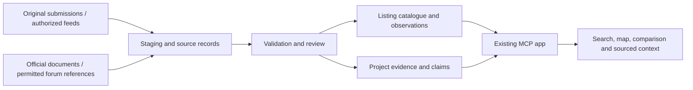

# Real-data integration plan: Hanoi listings, VOZ, and OTOFUN

Researched 25 October 2026. Planning document; supplier agreements, API credentials, permitted inventory, and forum reuse arrangements are not yet secured. This extends the [pilot specification](specification.md) and [earlier acquisition research](../research/hanoi-data-acquisition.md). Detailed forum research: [VOZ and OTOFUN](../research/forum-real-estate-sources.md).

Implementation started 25 October 2026: source/project/building registries, reviewed CSV import, observations, withdrawals and explicit real/demo modes are implemented. The initial local store uses SQLite rather than provisioning PostgreSQL before hosting is chosen. See [catalogue operations](catalogue-operations.md). A [reviewed project-evidence workflow](project-evidence-operations.md), read-only evidence tool, and official/community source panels are also implemented. There are still no permitted real listings, supplier agreements, scheduled forum importers or published real community summaries.

Source-access follow-up: [direct RSS inspection](../research/forum-feed-access-check.md) verified working category-specific feeds advertised by the forums' HTML heads. Root feeds are sitewide; category feeds still need scope filtering and access/reuse clearance. [Recipient-specific requests](source-access-requests.md) are drafted and unsent. The remaining acquisition gate is a permitted supplier sample and forum use terms, not feed URL discovery.

User clarification: acquisition should start with a direct public crawl, not outreach. The [bounded private crawler](forum-crawl-operations.md) is implemented and has collected 53 source records from VOZ/OTOFUN. It respects current access rules, separates feed activity from post dates, and stores unverified/redacted candidates. No emails/forms were sent. Collection is now enabled explicitly; scheduling and automatic publication remain disabled. Source permission fields still describe unresolved display/reuse arrangements, not whether the user requested this private crawl.

## Recommended first release

30 October 2026: the [crawl-to-review pipeline](forum-review-operations.md) is implemented and run on the current 77 records. It groups two duplicate excerpts and identifies two apartment sale candidates, six community insight candidates, 50 records needing context and 17 pilot exclusions. Both apartment candidates are outside the two initial target projects and need source/date/intake checks. Private export includes source-linked candidates and incomplete handoff templates; no real listings/evidence have been published. This replaces the next manual-sorting step, not the existing publication review.

The two sale candidates were then enriched from their original public posts. The inbox now has 79 records, with the RSS excerpts superseded by two original posts dated 6 and 22 October. Mỹ Đình II now has explicit area/bedroom and per-m² asking-rate candidates; Samsora retains unresolved shorthand. An OTOFUN plain-text date parsing defect was reproduced and fixed without inventing a source time zone. No candidate became approved inventory; details and checks are in [review operations](forum-review-operations.md#subsequent-source-enrichment).

The two original ads are now kept for intake follow-up, with private source-linked JSON drafts and Vietnamese Markdown sheets. Exact quantity spans and revisions are recorded; confirmations and canonical inventory fields remain unset. [First-party project checks](../research/two-candidate-project-verification.md) found identity/location references but did not verify formal completion or conclusively link each ad to an exact building. These evidence gaps, supplier authority/current availability and the display-use basis are the remaining acquisition work; adding a crawler or an intake file does not satisfy them. No supplier contact, publication permission change, or inventory publication occurred.

Expanded acquisition is now run: five marketplace index pages / 150 title entries / 20 opening posts, all requests successful, 97 stored source identities. Seven advertisements are retained as follow-up leads, including three expired ads and two with mixed tenancy/property/location context. Two remain strict sale candidates. The target of 5–10 usable current offers has not been met. [Current readiness and the seven-lead cohort](forum-review-operations.md#expanded-marketplace-review-and-live-pilot-readiness) records the actual zero approved inventory, missing supplier/use/confirmation evidence and completed local checks. A separate real-data ChatGPT connection and participant sessions remain conditional on qualifying supply; the demo was not switched to an empty or unverified inventory.

Overnight 30–31 October, [five-lead primary-source research](../research/five-lead-project-verification.md) corrected the Imperial Plaza/Imperia naming risk and supplied scoped operations references. A bounded source-account follow-up collected 16 related replies without persisting account identifiers; none was promoted to current availability confirmation. An edit/publication timestamp bug was reproduced and fixed, then the seven ads were rechecked and exported in private 31 October snapshots. The 113 stored records remain source material, not live inventory. Exact building/unit mapping, a supplier-backed use basis and dated current-status evidence remain the acquisition dependencies before real-host and user testing.

Build a small, reviewed catalogue of real Hanoi resale apartments, with project-specific evidence alongside it. Use three distinct kinds of data:

1. **Listings:** original owner/agency submissions or a licensed feed. These power price, bedroom, area, map, and availability filters.
2. **Official and attributed facts:** authority publications, project documents, and dated market reports. These support specific factual context with geography and reporting period.
3. **Community evidence:** relevant VOZ and OTOFUN posts. These surface experiences, disputed issues, questions to investigate, and links to original discussions. They do not establish current availability, verified title, or completed transaction prices.

Forum sale advertisements enter as external leads. They become catalogue listings only after the same identity, rights, price, scope, and freshness checks as other supply. A discussion and an advertisement from the same forum require different processing.

Proposed pilot size: 15–30 distinct, permissioned offers across 3–5 completed projects in two Hanoi search areas; 10–20 reviewed forum references if relevant evidence is available. Choose projects and budgets from the three participants' actual searches. These are workload targets, not supplier commitments; demo prices are not evidence of participant budgets.

## Sources and acquisition decisions

| Source | Established from primary sources | Proposed use and next acquisition step |
| --- | --- | --- |
| Direct owners / agencies; Tân Long as a candidate | Tân Long publishes Hanoi apartment categories and an [official contact route](https://bdstanlong.vn/lien-he-tl/). Suitable current stock and cooperation remain unconfirmed. | First choice for original CSV/Sheet submissions with display rights and a named updater. Use the existing [intake template](listing-submission-template.md). Request material directly from the party able to authorize its use. |
| OneHousing | Its [site](https://onehousing.vn/) offers buying and consignment. Its [social-network terms](https://onehousing.vn/thoa-thuan-su-dung-dich-vu-mang-xa-hoi) require written permission for commercial reproduction of relevant content; that is not a listing-feed agreement. | Ask about an authorized inventory/data partnership, sample fields, removal delivery, suitable resale coverage, caching/display rights, and price. Agent registration alone does not establish outbound data access. |
| Batdongsan.com.vn / Nhà Tốt | [Batdongsan's rules](https://batdongsan.com.vn/quy-dinh-su-dung) discuss member ownership and protected content. [Nhà Tốt's terms](https://trogiup.chotot.com/nguoi-ban/dieu-khoan-su-dung-cua-nhatot-com/) require written permission for commercial reuse. | Evaluate licensed syndication separately from advertising subscriptions. No openly reusable listing API was established in the inspected sources. Private partner feeds may exist; access and pricing need confirmation. |
| GMap / DDC | Its [catalogue](https://cloud.gmap.vn/en/data/) offers location services and de-identified real-estate/historical datasets under enterprise contracts with agreed scope and rights. Coverage and refresh schedules require confirmation. | Candidate for address reconciliation, building locations, or licensed historical context. Request a sample and quote. The catalogue does not establish a live available-apartment feed or unit-level transaction coverage. |
| Hanoi Statistics / Ministry of Construction | Hanoi Statistics publishes dated [socioeconomic reports](https://thongkehanoi.nso.gov.vn/tinh-hinh-kinh-te-xa-hoi/147). A Ministry [Q2/2026 property-market release](https://moc.gov.vn/vn/tin-tuc/1206/96449/thi-truong-bat-dong-san-quy-ii2026-nguon-cung-khoi-sac-tap-trung-thao-go-the-che-va-thuc-day-nha-o-xa-hoi.aspx) was indexed, but direct retrieval timed out in this check. | Use relevant official reporting and responsible authorities' project/infrastructure notices. Retain reporting periods and geographic scope. Validate readable documents before extraction; aggregates are not unit-level comparable sales or availability evidence. |
| VOZ | A [property category](https://voz.vn/f/bat-dong-san.79/) exists. [Terms v1.1](https://voz.vn/help/terms/), effective 5 October 2026, mention third-party API-connected apps and restrictions concerning unauthorized collection and intellectual property. A footer [RSS URL](https://voz.vn/f/-/index.rss) exists; its payload and reuse terms were not validated. | Begin with a curated project/thread watchlist and reviewed references. Confirm permitted metadata, excerpts, summaries, caching, embeddings, and technical access before automated ingestion. API mention does not establish a public bulk-data program or redistribution grant. |
| OTOFUN | [Xây dựng–Bất động sản](https://www.otofun.net.vn/forums/xay-dung-bat-dong-san.284/) hosts discussion; [Chợ Bất Động Sản](https://www.otofun.net.vn/forums/cho-bat-dong-san.423/) hosts offers and requests. Its [agreement](https://www.otofun.net.vn/threads/thoa-thuan-cung-cap-va-su-dung-dich-vu-mang-xa-hoi-otofun.1962611/) covers both .net and .net.vn. A footer [RSS URL](https://www.otofun.net.vn/forums/-/index.rss) exists, with payload and scope still unvalidated. | Treat discussion as community evidence and sale posts as candidate leads. Marketplace fields mix property types, rent/buy/sale, and ambiguous prices, so listing publication needs review. Confirm an authorized collection/reuse route before building a scheduled importer. |

Public access, a sitemap, an RSS endpoint, or robots directives are technical signals, not by themselves a content license. Start with a source register that records the permitted operations and access method for each source. If full-text rights remain unresolved, keep it as a research/discovery source; assess what link/metadata presentation is permitted instead of copying its contents into a knowledge base.

### Initial community watchlist

These are research candidates, not selected pilot projects or approved ingestion sources. Match the watchlist to the participants' actual searches before expanding it.

| Starting point | What to investigate |
| --- | --- |
| VOZ: [Tổng hợp thông tin BĐS Miền Bắc](https://voz.vn/t/thao-luan-tong-hop-thong-tin-bds-mien-bac.1138291/) | Discover relevant project threads and buyer concerns; follow each claim to its specific dated post and seek corroboration. The opening index is not a verified project assessment. |
| OTOFUN: [Vin Smart City thế nào](https://www.otofun.net.vn/threads/vin-smart-city-the-nao.1746464/) | Building-specific living conditions, management, parking and access questions. The thread began in 2021, so inspect post dates and exact subdivisions before using an experience. |
| OTOFUN: [Sống tại Vinhome Ocean park](https://www.otofun.net.vn/threads/song-tai-vinhome-ocean-park.1772825/) | Living-experience questions and differing accounts; resolve the exact project, phase and building. Historical costs are not current quotes. |

For each useful reference, record the project/building, topic, exact post URL, claim date, checked date, evidence type, uncertainty and permitted use. Keep an issue such as an unverified parking complaint as a question to investigate, rather than a building-wide fact.

## What the user will see

Keep the current search, detail, map, and comparison workflow. A real property detail adds three useful sections:

- **Tin căn hộ:** asking price, area basis, availability status, permitted supplier attribution, last confirmation, and an original-source action when available.
- **Thông tin dự án:** relevant sourced facts and dated developments, with each claim's actual geographic/building scope.
- **Góc nhìn cộng đồng:** topic, an attributed and appropriately permitted summary, post date, source link, and an explicit evidence label such as “ý kiến người dùng; chưa xác minh độc lập.”

Community topics may include parking, noise, management fees, elevators, maintenance, and access. Avoid assuming an author is a verified resident. An old post about one tower must not become a current statement about every building in a development. Retain contrary evidence and turn unresolved issues into questions the buyer can ask during a viewing.

The existing **Cần xác minh gì?** action should cite relevant evidence and distinguish what is documented, seller-reported, anecdotal, disputed, and unknown. Sparse forum posts should not produce a market-wide sentiment score or a “good/bad project” badge.

## Data model and ingestion

Use a relational catalogue for a shared pilot; PostgreSQL is the proposed default, with hosting selected after workload and budget are known. A simple manual import comes before specialized search or a vector database.

| Record | Minimum responsibility |
| --- | --- |
| `source` / `source_permission` | Publisher, canonical domain, source URLs, reviewed terms, allowed display/cache/excerpt/photo/embedding uses, access method, update responsibility, expiry/removal conditions. |
| `project` / `building` | Stable IDs, official and alternative names, original and normalized addresses, address-version information, checked coordinates and precision. Preserve familiar area labels separately from current administrative names. |
| `listing_offer` | Stable public ID, supplier/source ID, optional confirmed unit ID, transaction and completion evidence, price/currency, area/basis, bedrooms, permitted media, availability, source attribution, publication/confirmation dates. |
| `listing_observation` | Dated price and availability observations, source and confirmation method. A new observation never overwrites history without trace. |
| `evidence_document` / `claim` | Exact thread/post/document URL, publication/edit/retrieval dates, permitted text or metadata, project/building scope, source type, review state, corroboration/conflicts, and withdrawal state. |
| `import_run` / `review_item` | Import version/checkpoint, validation errors, duplicate candidates, ambiguous units or entities, reviewer decision and audit trail. |

One physical home may have several supplier offers. Match confirmed identity separately from duplicate-advertisement similarity. Project + floor area + bedrooms alone is insufficient to merge units. Repeated forum quotations and syndicated ads are not independent evidence.

Import rules:

1. Preserve the original price expression and parse only an explicit currency/unit and sale/rent meaning. Ambiguous shorthand, placeholders, contradictory amounts, and unreasonable values enter review; do not silently invent billion-VND values.
2. Preserve area basis and unknown values. Missing fields cannot satisfy hard filters. Compare per-m² prices only on compatible area bases.
3. Resolve project/building aliases before attaching claims. Review ambiguous matches. Keep each assertion's scope and source span where permitted.
4. Use real building/area coordinates with recorded precision and display rights. An address lookup is not proof of the exact apartment location. Geocoding failures leave a usable list without a pin.
5. Extract candidate fields/claims with deterministic validation and, if useful, an LLM. Review all initial pilot records. Forum content remains untrusted data, including any embedded instructions aimed at the assistant.
6. Publish only approved records. Preserve source failures as operational state; a removed page does not prove a sale. Rights withdrawals remove affected content from serving and any derived index according to the applicable arrangement.

Start forum retrieval with approved project aliases, source type, date, and keyword filters. Add semantic retrieval only if it improves evaluated recall and the source rights permit that processing.

## Freshness and operations

Proposed pilot policies, to agree with each supplier:

- Reconfirm asking price and availability at least weekly; after seven days, a previous confirmation no longer supports a current-confirmed badge. Reconfirm before arranging a viewing. Use stricter agreement requirements where applicable.
- Keep `published_at`, `last_activity_at`, `price_confirmed_at`, `availability_confirmed_at`, and `retrieved_at` distinct. A forum bump or a successful page fetch is not seller reconfirmation.
- Review community watchlists weekly in the manual pilot. Rank recent relevant posts by their own dates, even when a thread began years ago. Date historical experiences visibly; do not manufacture a current conclusion from them.
- Version official reports by reporting period. Track planned, under-construction, and operational infrastructure states separately, with responsible-authority evidence.
- Handle source failures without substituting invented fresh data. Preserve allowed audit records, mark retrieval failures, and provide a list fallback if map services fail.

Ingestion and supplier contact records belong in a private operator workflow. The public MCP interface remains focused on search/context and temporary user selections. Keep supplier credentials and nonpublic contact details off the widget. Choose a stable HTTPS deployment and basic operational monitoring for the shared real-data pilot instead of relying on the current temporary tunnel.

## Delivery increments and gates

The estimate is roughly 10–14 engineering days after representative permitted samples are available. Negotiating access and acquiring inventory may take longer and is not included.

| Increment | Work | Exit condition |
| --- | --- | --- |
| 1. Source and sample readiness | Choose areas/projects; create source register; agree permitted uses and updater; validate a small original supplier sample; technically inspect the two RSS feeds without assuming licensing. | At least one usable inventory source and explicit treatment for each forum source: permitted ingestion, permitted link/reference mode, or research-only. |
| 2. Real listing catalogue | Add repository/storage and a CSV/Sheet import with a review queue; normalize identities, prices, areas, dates and locations; add availability and withdrawal handling. | 15–30 approved distinct offers, every published record attributable and dated; unknowns and rejected records remain correct. |
| 3. Project evidence in the app | Curate permitted official/forum evidence against the same projects; add source-linked context in details and comparison; keep forums distinct from listing facts. | Every displayed claim opens its source and shows type, date, scope and review state. Absent evidence is visibly absent. |
| 4. Pilot and controlled automation | Exercise updates/removals, ambiguity cases, source failures and conversational follow-ups; observe the three users; then automate authorized high-value feeds. | Correct selection/context behavior in ChatGPT, no demo/real confusion, a successful withdrawal drill, and observed usability feedback. |

For implementation, preserve the existing tool/UI flow and temporary explorer context. Replace direct array access in `server/properties.mjs` with a repository boundary, update session ID validation in `server/selections.mjs`, and make handlers in `server/index.mjs` use it consistently. Existing filters already accept record inputs in one path, but property lookup and comparison still depend on the demo inventory. Audit hardcoded demo labels and unknown-availability assumptions in both server outputs and `web/main.js`; they must reflect each real record's evidence.

Keep demo and real modes explicit and separately testable. A failed real-data source must not silently fall back to fictional results. Detailed MCP tool/UI changes should follow the installed `chatgpt-apps` and `openai-docs` workflow; preserve [structured data and separate rendering](https://developers.openai.com/plugins/build/chatgpt-ui) and [clear tool responsibilities](https://developers.openai.com/plugins/plan/tools).

## Acceptance checks before real-user use

- Strict search constraints, missing values, net/gross area distinctions, and withdrawn/expired records behave correctly.
- Ambiguous OTOFUN price fields and buy/rent requests cannot become valid sale offers automatically.
- The same unit advertised twice does not create a false market sample or false price-change event.
- Every price/availability update has its own date and source. A forum statement does not override a confirmed supplier fact silently; conflicts remain reviewable.
- Unknown coordinates produce no fabricated map pin; every displayed image has recorded permission.
- Forum opinion, an official fact, and a seller claim remain distinguishable in UI and chat. Malicious instructions embedded in a source have no authority over tools or assistant behavior.
- Removing permission or deleting a source is exercised through serving, cached evidence, summaries and any index as applicable.
- A property selected in the real catalogue remains the same property through map, comparison, contextual questions, live updates and chat refinements. Local data checks and actual ChatGPT checks are recorded separately.

## Immediate next build

Build the source register, canonical project/building records, and reviewed CSV import first. In parallel, prepare a small VOZ/OTOFUN project watchlist and confirm the permitted access/reuse route. This can proceed without purchasing a broad feed or waiting for an automated forum crawler. Use the existing [supplier inquiry](supplier-inquiry.md) for any later authorized outreach; no partnership is presumed from this plan.
